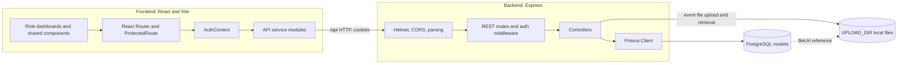

# Overall System Architecture

## Purpose

Shows implemented application boundaries.

## Mermaid diagram

## Brief explanation

Implemented architecture. File persistence depends on deployment configuration.

## Actors involved

Frontend: all roles. Backend: Express, Prisma. Storage: PostgreSQL and local files.

## Relevant APIs

All API routes are mounted under /api; GET /api/health.

## Relevant database models

User, Department, Club, Event, Attendance, Document, CertificateRecord, RefreshSession.

## Implementation status

Implemented architecture. File persistence depends on deployment configuration.
