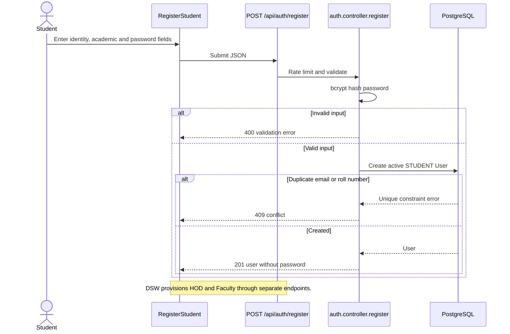

# User Registration Flow

## Purpose

Shows public Student registration and distinguishes DSW-provisioned staff.

## Mermaid diagram

## Brief explanation

Student registration implemented. Initial DSW account creation is not established by these endpoints.

## Actors involved

Student; DSW for staff provisioning.

## Relevant APIs

POST /api/auth/register; POST /api/users/hod; POST /api/users/faculty.

## Relevant database models

User.

## Implementation status

Student registration implemented. Initial DSW account creation is not established by these endpoints.
