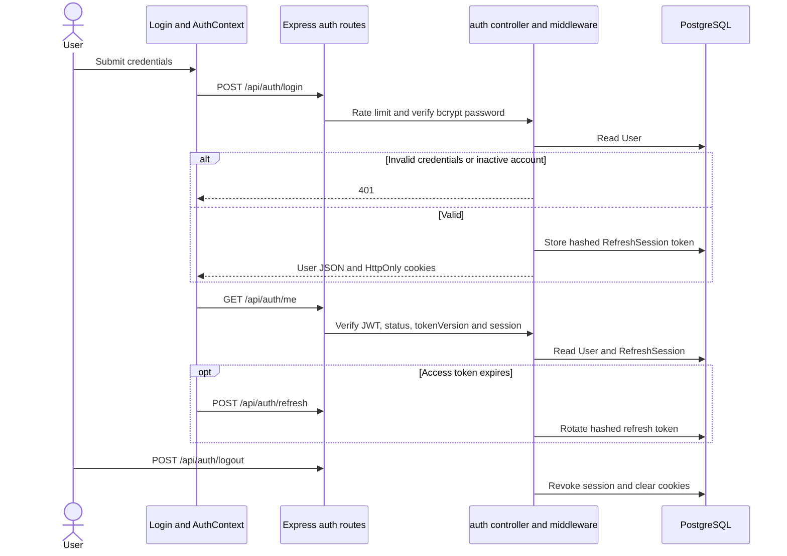

# User Login and Authentication Flow

## Purpose

Shows login, cookie session restoration, refresh, logout and backend checks.

## Mermaid diagram

## Brief explanation

Implemented. Password reset/change endpoint not found.

## Actors involved

User; frontend API client; backend auth controller/middleware.

## Relevant APIs

POST /api/auth/login; GET /api/auth/me; POST /api/auth/refresh; POST /api/auth/logout.

## Relevant database models

User, RefreshSession.

## Implementation status

Implemented. Password reset/change endpoint not found.
