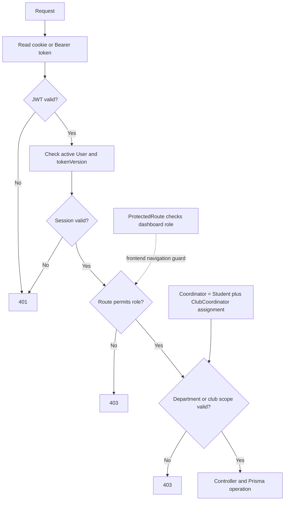

# Role-Based Access Control Flow

## Purpose

Separates frontend navigation guards from server authorization.

## Mermaid diagram

## Brief explanation

Implemented role gates and resource checks. Frontend guard alone is not authorization.

## Actors involved

DSW, HOD, Faculty Incharge, Student; coordinator is an assignment privilege.

## Relevant APIs

Role gates in backend/src/routes; GET /api/auth/me.

## Relevant database models

User, RefreshSession, ClubCoordinator, Club, Department, Event.

## Implementation status

Implemented role gates and resource checks. Frontend guard alone is not authorization.
