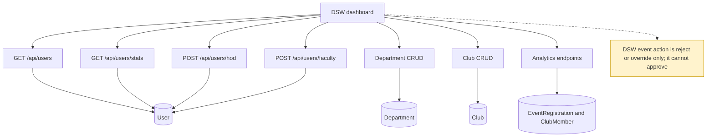

# DSW Administration Flow

## Purpose

Shows verified administrative APIs and DSW event decision limitation.

## Mermaid diagram

## Brief explanation

Implemented administration routes. Initial DSW account creation is unverified.

## Actors involved

DSW; provisioned HOD and Faculty.

## Relevant APIs

GET /api/users; GET /api/users/stats; POST /api/users/hod; POST /api/users/faculty; department, club, analytics endpoints.

## Relevant database models

User, Department, Club, EventRegistration, ClubMember.

## Implementation status

Implemented administration routes. Initial DSW account creation is unverified.
