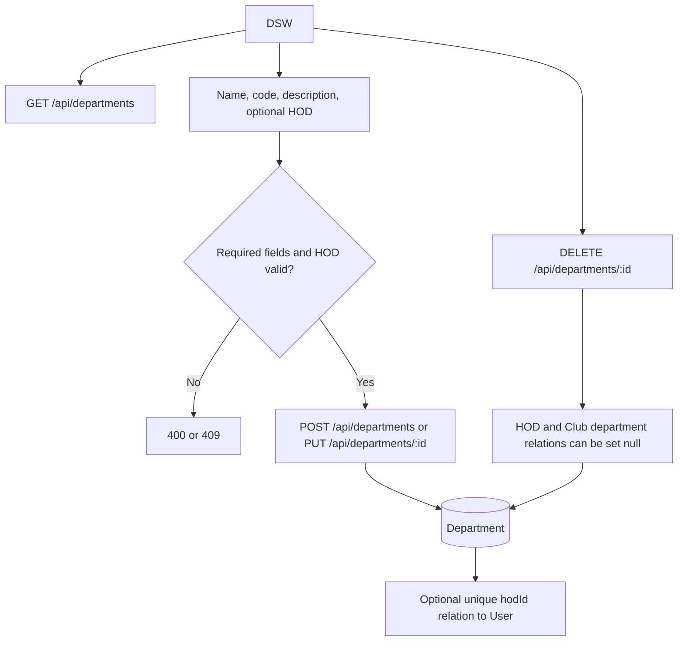

# Department Management Flow

## Purpose

Shows DSW department CRUD and optional unique HOD assignment.

## Mermaid diagram

## Brief explanation

Implemented. Department and student branch fields may differ.

## Actors involved

DSW; optional HOD.

## Relevant APIs

GET/POST /api/departments; PUT/DELETE /api/departments/:id.

## Relevant database models

Department, User, Club.

## Implementation status

Implemented. Department and student branch fields may differ.
