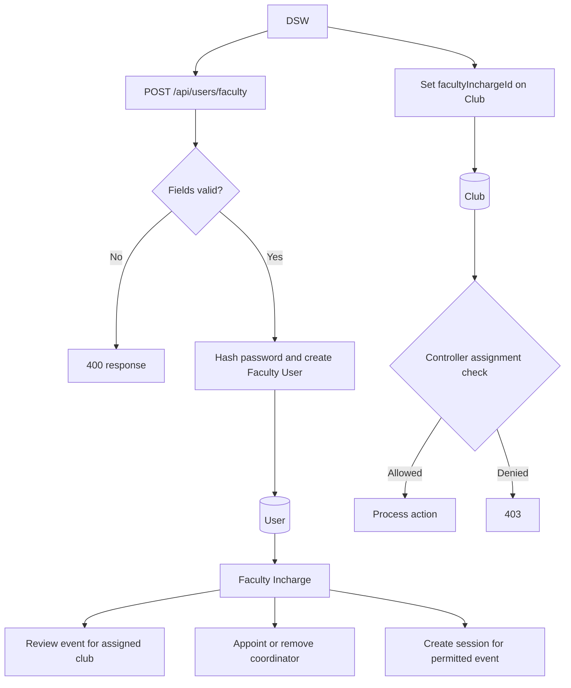

# Faculty Management Flow

## Purpose

Shows DSW provisioning and Faculty operations constrained to assigned clubs.

## Mermaid diagram

## Brief explanation

Implemented. Faculty accounts are User rows, not a separate model.

## Actors involved

DSW; Faculty Incharge; Students in assigned clubs.

## Relevant APIs

POST /api/users/faculty; POST/PUT /api/clubs; POST /api/clubs/:id/appoint-coordinator; POST /api/events/:id/approval; POST /api/events/attendance/sessions.

## Relevant database models

User, Club, ClubCoordinator, Event, AttendanceSession.

## Implementation status

Implemented. Faculty accounts are User rows, not a separate model.
