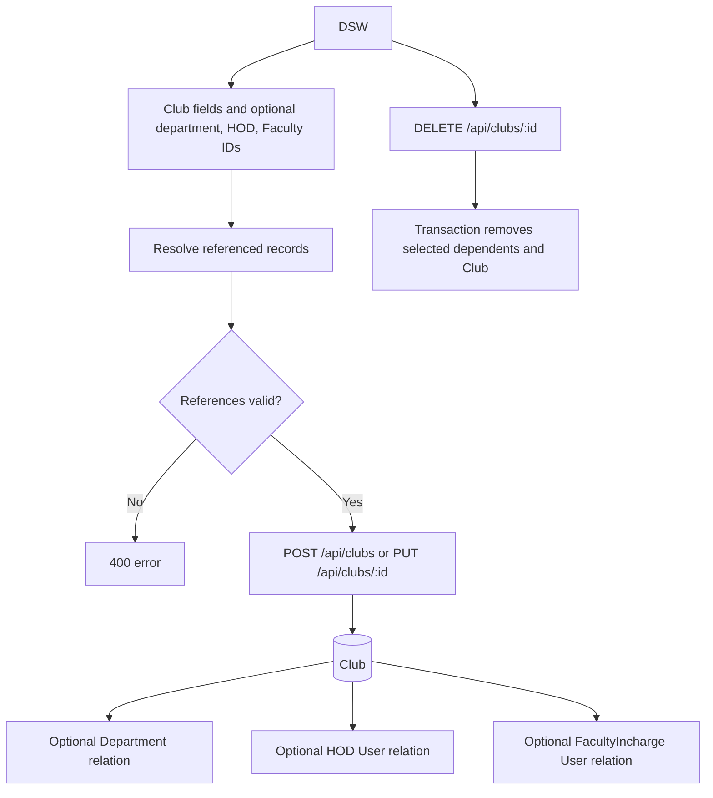

# Club Creation and Management Flow

## Purpose

Shows DSW club CRUD and optional relational assignments.

## Mermaid diagram

## Brief explanation

Implemented. Delete does not explicitly remove every dependent type, including certificate records and attendance sessions.

## Actors involved

DSW; HOD; Faculty Incharge; Student members.

## Relevant APIs

GET/POST /api/clubs; PUT/DELETE /api/clubs/:id.

## Relevant database models

Club, Department, User, ClubMember, ClubCoordinator, Event, EventApproval, EventRegistration, Attendance, Document.

## Implementation status

Implemented. Delete does not explicitly remove every dependent type, including certificate records and attendance sessions.
