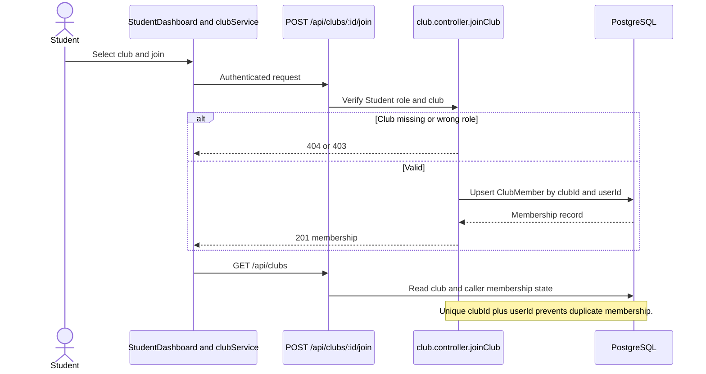

# Club Membership Flow

## Purpose

Shows student club join and duplicate prevention.

## Mermaid diagram

## Brief explanation

Implemented. Leave/unjoin endpoint not found.

## Actors involved

Student; backend.

## Relevant APIs

POST /api/clubs/:id/join; GET /api/clubs.

## Relevant database models

Club, ClubMember, User.

## Implementation status

Implemented. Leave/unjoin endpoint not found.
