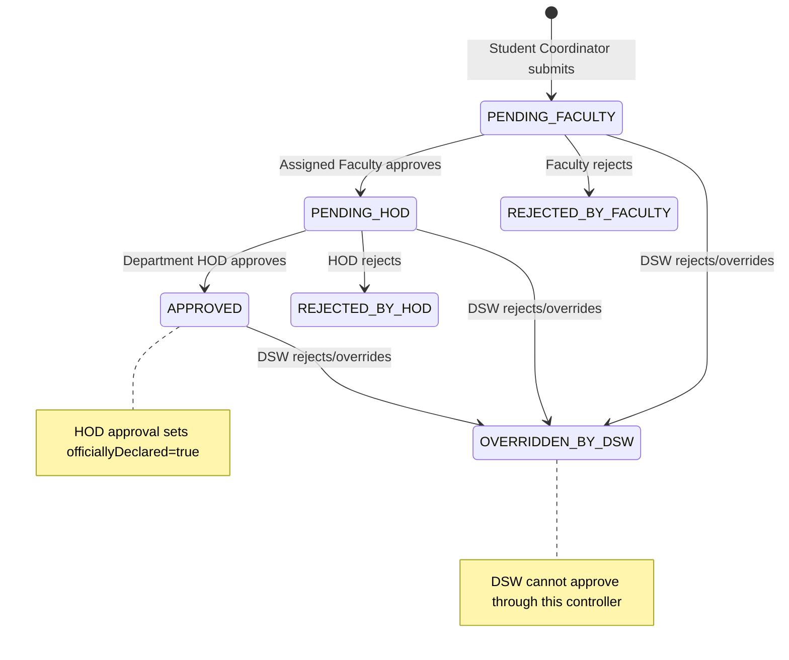

# Complete Event Approval Flow

## Purpose

Shows actual review path and DSW reject/override behavior.

## Mermaid diagram

## Brief explanation

Faculty then HOD approval is implemented. DSW may reject/override but is not a required final approver.

## Actors involved

Student Coordinator; assigned Faculty; department HOD; DSW.

## Relevant APIs

POST /api/events/:id/approval; alias POST /api/events/:id/approve.

## Relevant database models

Event, EventApproval, Notification, ActivityLog, Club, User.

## Implementation status

Faculty then HOD approval is implemented. DSW may reject/override but is not a required final approver.
