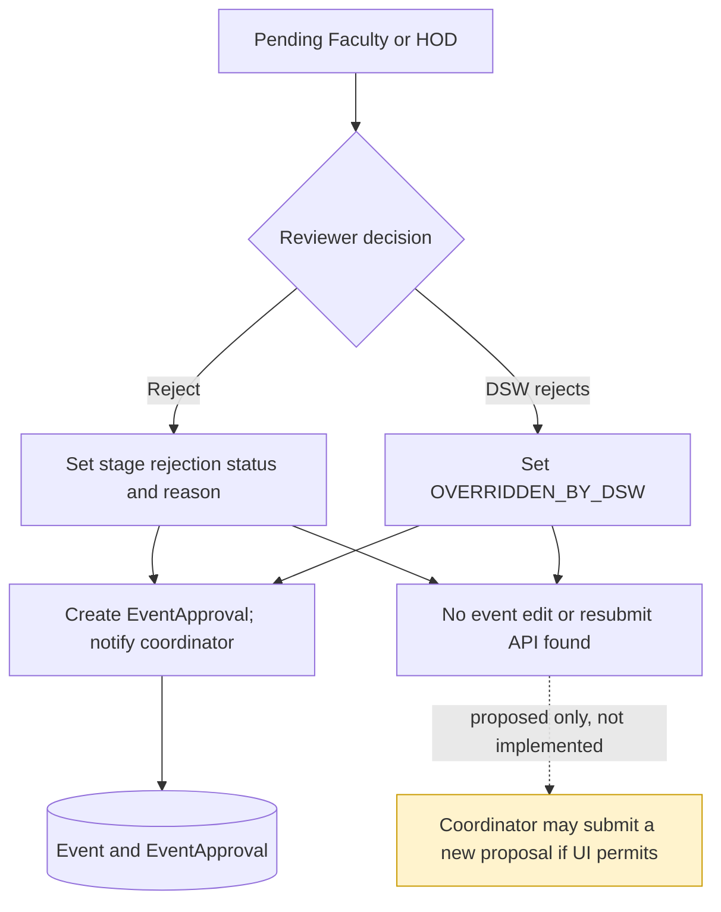

# Event Rejection and Resubmission Flow

## Purpose

Distinguishes implemented rejection from absent same-event proposal revision.

## Mermaid diagram

## Brief explanation

Rejection is implemented. Resubmission/revision of the same event is not found in routes/controllers.

## Actors involved

Faculty Incharge, HOD, DSW, Student Coordinator.

## Relevant APIs

POST /api/events/:id/approval; POST /api/events for a new proposal.

## Relevant database models

Event, EventApproval, Notification, ActivityLog.

## Implementation status

Rejection is implemented. Resubmission/revision of the same event is not found in routes/controllers.
