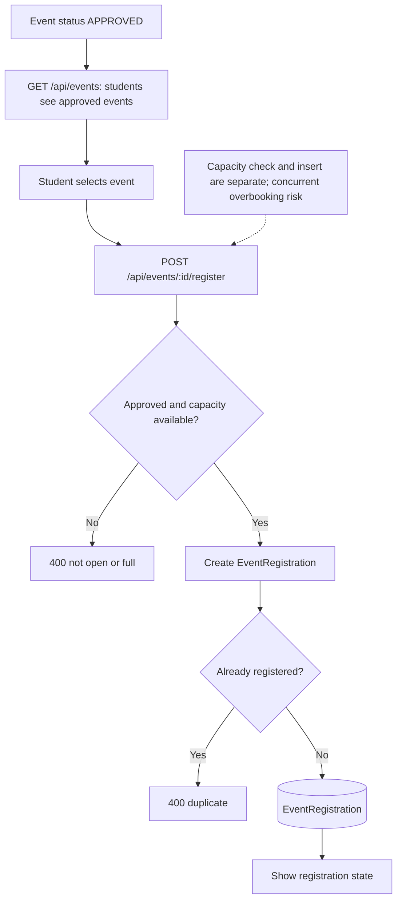

# Event Publication and Student Registration Flow

## Purpose

Shows APPROVED status as publication and student registration.

## Mermaid diagram

## Brief explanation

Implemented. Publication is the APPROVED status; no separate publish API.

## Actors involved

HOD approves; Student registers.

## Relevant APIs

GET /api/events; POST /api/events/:id/register.

## Relevant database models

Event, Club, EventRegistration, User.

## Implementation status

Implemented. Publication is the APPROVED status; no separate publish API.
