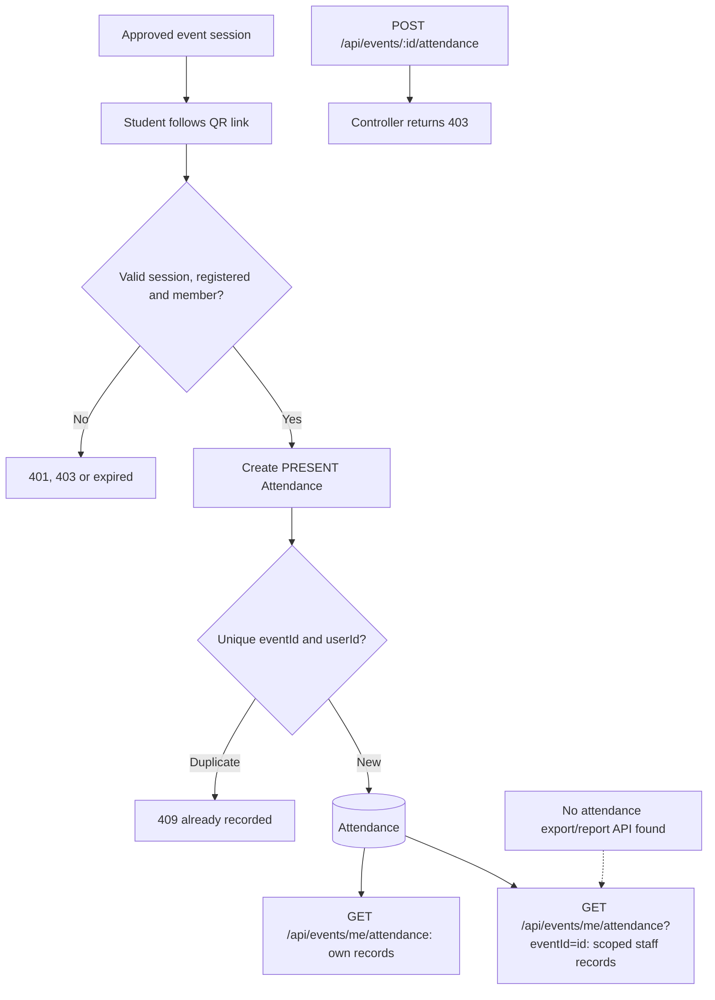

# Attendance Management and Reporting Flow

## Purpose

Shows attendance record creation and role-scoped listing, with legacy path noted.

## Mermaid diagram

## Brief explanation

Record/listing implemented. Reporting is limited; legacy direct-mark endpoint is not an alternate path.

## Actors involved

Student; Faculty Incharge; HOD; DSW.

## Relevant APIs

GET /api/events/me/attendance; QR session endpoints; legacy POST /api/events/:id/attendance returns 403.

## Relevant database models

Attendance, AttendanceSession, Event, User, Club.

## Implementation status

Record/listing implemented. Reporting is limited; legacy direct-mark endpoint is not an alternate path.
