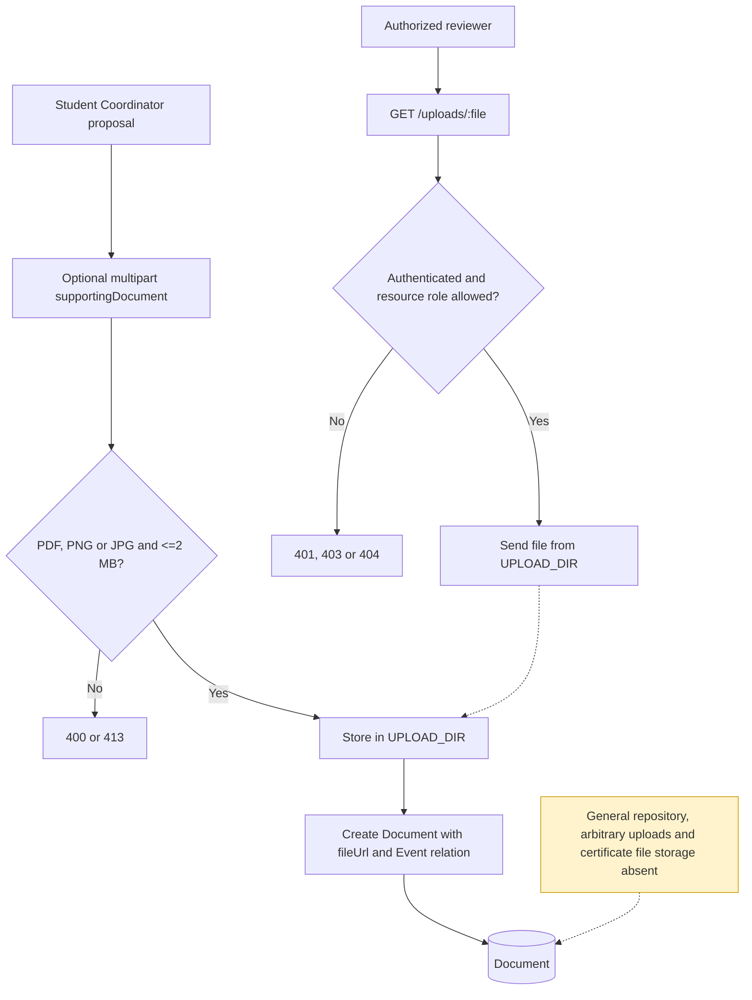

# Document Repository Flow

## Purpose

Documents implemented are event proposal attachments, not a general repository.

## Mermaid diagram

## Brief explanation

Partial. Event proposal file upload and protected retrieval exist; no general repository API found.

## Actors involved

Student Coordinator; Faculty; department HOD; DSW; authorized reader.

## Relevant APIs

POST /api/events multipart; authenticated GET /uploads/:file.

## Relevant database models

Document, Event, Club, User.

## Implementation status

Partial. Event proposal file upload and protected retrieval exist; no general repository API found.
