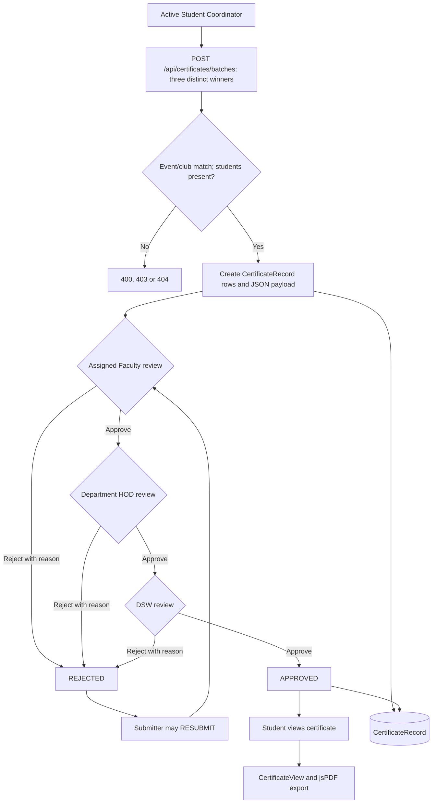

# Certificate Generation and Distribution Flow

## Purpose

Shows three-student certificate batch, approvals, resubmission and client PDF export.

## Mermaid diagram

## Brief explanation

Approval and client PDF export implemented. No separate certificate file storage/delivery API found.

## Actors involved

Active Student Coordinator; Faculty; HOD; DSW; certificate recipient Student.

## Relevant APIs

GET /api/certificates; POST /api/certificates/batches; PATCH /api/certificates/:id with APPROVE, REJECT or RESUBMIT.

## Relevant database models

CertificateRecord, User, Event, Club, Attendance.

## Implementation status

Approval and client PDF export implemented. No separate certificate file storage/delivery API found.
