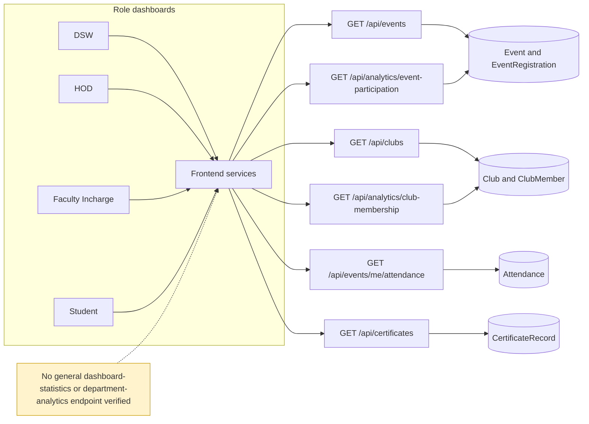

# Dashboard and Analytics Data Flow

## Purpose

Shows role dashboards and the limited aggregate analytics endpoints.

## Mermaid diagram

## Brief explanation

Dashboards implemented. Aggregates are limited to event registrations and club membership.

## Actors involved

DSW, HOD, Faculty Incharge, Student.

## Relevant APIs

GET /api/events; GET /api/clubs; GET /api/events/me/attendance; GET /api/certificates; GET /api/analytics/event-participation; GET /api/analytics/club-membership.

## Relevant database models

Event, EventRegistration, Club, ClubMember, Attendance, CertificateRecord, User.

## Implementation status

Dashboards implemented. Aggregates are limited to event registrations and club membership.
