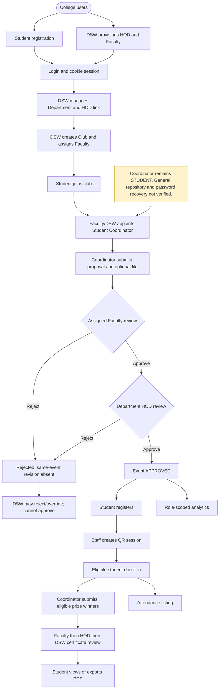

# Complete End-to-End System Workflow

## Purpose

Connects source-verified account, club, event, attendance, certificate and analytics stages.

## Mermaid diagram

## Brief explanation

End-to-end modules exist in source; production and live behavior unverified. DSW event permission is reject/override only.

## Actors involved

Student, Student Coordinator privilege, Faculty Incharge, HOD, DSW.

## Relevant APIs

Uses auth, user, department, club, event, attendance, certificate and analytics endpoints documented in files 02-19.

## Relevant database models

User, Department, Club, ClubMember, ClubCoordinator, Event, EventApproval, EventRegistration, AttendanceSession, Attendance, Document, CertificateRecord, RefreshSession.

## Implementation status

End-to-end modules exist in source; production and live behavior unverified. DSW event permission is reject/override only.
